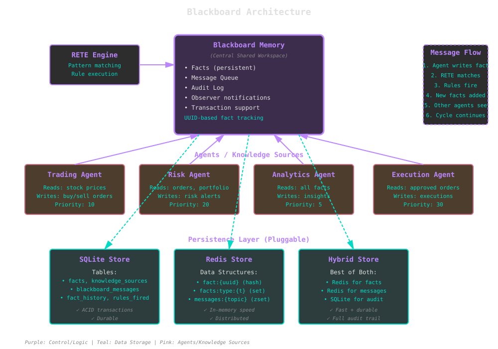

# Blackboard Architecture

The Blackboard pattern is a powerful approach to multi-agent problem-solving where independent knowledge sources collaborate through a shared workspace.

## Overview



*Blackboard system with multiple agents reading and writing to shared persistent memory with pluggable storage backends.*

## Core Concept

The blackboard architecture consists of three main components:

1. **Blackboard (Memory)**: Central shared workspace for facts
2. **Knowledge Sources (Agents)**: Independent experts that read and write facts
3. **Control Component**: Coordinates agent execution (often via rules)

Agents operate asynchronously, triggered by changes to the blackboard state. Each agent:
- Reads relevant facts from the blackboard
- Performs reasoning or computation
- Writes conclusions back to the blackboard
- Triggers other agents via fact changes

## KBS Implementation

### Blackboard::Memory

The central workspace that replaces `WorkingMemory` with persistence:

```ruby
require 'kbs/blackboard'

# Create blackboard with SQLite backend
memory = KBS::Blackboard::Memory.new(db_path: 'knowledge_base.db')

# Add facts (persisted automatically)
fact = memory.add_fact(:stock, {
  symbol: "AAPL",
  price: 150.50,
  timestamp: Time.now
})
# => #<KBS::Blackboard::Fact @uuid="abc-123..." ...>

# Query facts
stocks = memory.get_facts(:stock)
# => [#<KBS::Blackboard::Fact ...>, ...]
memory.get_facts(:stock, symbol: "AAPL")   # filter by attributes too

# Facts survive process restart
memory.close
memory2 = KBS::Blackboard::Memory.new(db_path: 'knowledge_base.db')
memory2.get_facts(:stock)
# => Still there!
```

**Implementation**: `lib/kbs/blackboard/memory.rb`

### Blackboard::Engine

RETE engine with persistent blackboard memory:

```ruby
# Create engine with blackboard
engine = KBS::Blackboard::Engine.new(db_path: 'trading.db')

# Define rules using DSL (rules live in the engine; only facts,
# messages and the audit log are persisted)
kb = KBS.knowledge_base(engine: engine) do
  kb = self  # the knowledge base, for use inside actions

  rule "buy_signal" do
    on :stock, symbol: :sym?, price: :price?
    on :threshold, symbol: :sym?, max: :max?

    perform do |facts, bindings|
      if bindings[:price?] < bindings[:max?]
        # Write new fact to blackboard (a bare `fact` works too)
        kb.fact :order,
          symbol: bindings[:sym?],
          action: "BUY",
          price: bindings[:price?]
      end
    end
  end

  # Facts trigger rules, which create new facts
  fact :stock, symbol: "AAPL", price: 145.0
  fact :threshold, symbol: "AAPL", max: 150.0
  run
  # => Creates :order fact in blackboard
end
```

`Blackboard::Engine` also writes each rule firing to the audit log, and `engine.modify(fact, changes)` keeps the fact's uuid and logs an `UPDATE`.

**Implementation**: `lib/kbs/blackboard/engine.rb`

### Message Queue

Priority-based communication between agents:

```ruby
memory = KBS::Blackboard::Memory.new(db_path: 'system.db')

# Agent 1: Post high-priority message (sender, topic, content)
memory.post_message("volatility_monitor", "risk_analysis", {
  alert: "High volatility detected",
  severity: "critical"
}, priority: 10)

# Look without consuming: highest priority first, then oldest
memory.peek_messages("risk_analysis", limit: 5)

# Agent 2: Take the next message; each message goes to one consumer
while (msg = memory.consume_message("risk_analysis", "risk_agent"))
  puts "Processing: #{msg[:content][:alert]}"
end
```

`memory.message_queue` is the underlying `MessageQueue` (or `RedisMessageQueue`), with `post`, `consume`, `peek` and `stats`. A consumed message is marked consumed and is not handed out again.

**Implementation**: `lib/kbs/blackboard/message_queue.rb`

### Audit Log

Complete history of all changes for compliance and debugging:

```ruby
memory = KBS::Blackboard::Memory.new(db_path: 'audit.db')
audit = memory.audit_log

# All fact changes are logged automatically
fact = memory.add_fact(:stock, symbol: "AAPL", price: 150)
fact.update(price: 155)          # merges and writes through to the store
memory.remove_fact(fact)

# Query audit trail (newest first)
history = audit.fact_history(fact.uuid)
# => [
#   { fact_uuid: ..., fact_type: :stock, action: "REMOVE", attributes: {symbol: "AAPL", price: 155}, timestamp: ..., session_id: ... },
#   { ..., action: "UPDATE", attributes: {symbol: "AAPL", price: 155}, ... },
#   { ..., action: "ADD",    attributes: {symbol: "AAPL", price: 150}, ... }
# ]

# See what rules fired (logged by Blackboard::Engine)
rule_log = audit.rule_firings(limit: 10)
# => [
#   { rule_name: "buy_signal", fact_uuids: [...], bindings: {...}, fired_at: ..., session_id: ... },
#   ...
# ]

# Recent changes across all facts
recent = audit.fact_history(limit: 20)
```

`memory.get_history(uuid = nil, limit:)` and `memory.get_rule_firings(name = nil, limit:)` are shortcuts for the same queries.

**Implementation**: `lib/kbs/blackboard/audit_log.rb`

## Persistence Backends

### SQLite Store (Default)

Best for: Single-process applications, development, small-to-medium data.

```ruby
engine = KBS::Blackboard::Engine.new(db_path: 'kb.db')
```

**Pros:**
- ✅ Zero configuration (no server needed)
- ✅ ACID transactions
- ✅ Durable across restarts
- ✅ Simple backup (copy .db file)
- ✅ SQL queries over facts (`memory.query_facts`)

**Cons:**
- ⚠️ Usually slower than Redis for writes
- ⚠️ Single-writer limitation
- ⚠️ Not distributed

**Schema** (abridged; see `sqlite_store.rb`, `audit_log.rb`, `message_queue.rb`):
```sql
CREATE TABLE facts (
  id INTEGER PRIMARY KEY AUTOINCREMENT,
  uuid TEXT UNIQUE NOT NULL,
  fact_type TEXT NOT NULL,
  attributes TEXT NOT NULL,   -- JSON
  created_at TIMESTAMP DEFAULT CURRENT_TIMESTAMP,
  updated_at TIMESTAMP DEFAULT CURRENT_TIMESTAMP,
  session_id TEXT,
  retracted BOOLEAN DEFAULT 0, -- removed facts are kept, marked retracted
  retracted_at TIMESTAMP
  -- ... plus fact_timestamp, market_timestamp, data_source, market_session
);

CREATE TABLE fact_history (
  id INTEGER PRIMARY KEY AUTOINCREMENT,
  fact_uuid TEXT NOT NULL,
  fact_type TEXT NOT NULL,
  attributes TEXT NOT NULL,   -- JSON
  action TEXT NOT NULL,       -- ADD, UPDATE, REMOVE
  timestamp TIMESTAMP DEFAULT CURRENT_TIMESTAMP,
  session_id TEXT
);

CREATE TABLE rules_fired (
  id INTEGER PRIMARY KEY AUTOINCREMENT,
  rule_name TEXT NOT NULL,
  fact_uuids TEXT NOT NULL,   -- JSON
  bindings TEXT,              -- JSON
  fired_at TIMESTAMP DEFAULT CURRENT_TIMESTAMP,
  session_id TEXT
);

CREATE TABLE blackboard_messages (
  id INTEGER PRIMARY KEY AUTOINCREMENT,
  sender TEXT NOT NULL,
  topic TEXT NOT NULL,
  content TEXT NOT NULL,      -- JSON
  priority INTEGER DEFAULT 0,
  posted_at TIMESTAMP DEFAULT CURRENT_TIMESTAMP,
  consumed BOOLEAN DEFAULT 0,
  consumed_by TEXT,
  consumed_at TIMESTAMP
);

CREATE TABLE knowledge_sources (...);
```

**Implementation**: `lib/kbs/blackboard/persistence/sqlite_store.rb`

### Redis Store

Best for: High-throughput applications, distributed systems, real-time trading.

```ruby
store = KBS::Blackboard::Persistence::RedisStore.new(
  url: 'redis://localhost:6379/0'
)
engine = KBS::Blackboard::Engine.new(store: store)
```

**Pros:**
- ✅ In-memory, typically faster than SQLite for reads/writes (measure for your workload)
- ✅ Several processes can share one store (facts, messages, audit)
- ✅ Atomic operations (MULTI for fact writes, ZPOPMIN for message consumption)

**Cons:**
- ⚠️ Requires Redis server and the `redis` gem
- ⚠️ Volatile by default (enable RDB/AOF for durability)
- ⚠️ More complex deployment
- ⚠️ No SQL: `query_facts` raises `NotImplementedError`

**Data Structures:**
```
# Facts stored as Redis hashes (attributes as JSON)
fact:{uuid} → { uuid, type: "stock", attributes: '{"symbol":"AAPL","price":150}',
                session_id, created_at, updated_at, retracted: "0" }

# Indexes for efficient queries
facts:type:stock → Set of fact UUIDs
facts:active → Set of all active fact UUIDs
facts:all, facts:session:{id} → Sets

# Messages: a hash each, ordered per topic in a sorted set (score from priority, then time)
message:{id} → { sender, topic, content, priority, posted_at, consumed, ... }
messages:risk_alerts → ZSet of message ids

# Audit as lists (newest first, trimmed)
fact_history:{uuid}, fact_history:all → List of change records
rules_fired:{rule}, rules_fired:all → List of rule executions
```

**Implementation**: `lib/kbs/blackboard/persistence/redis_store.rb`

### Hybrid Store

Best for: Production systems needing speed + durability + audit.

```ruby
store = KBS::Blackboard::Persistence::HybridStore.new(
  redis_url: 'redis://localhost:6379/0',
  db_path: 'audit.db'
)
engine = KBS::Blackboard::Engine.new(store: store)
```

**Strategy:**
- **Redis**: Facts and messages (fast access)
- **SQLite**: Audit log (durable history)

**Pros:**
- ✅ Fast fact operations (Redis)
- ✅ Durable audit trail (SQLite)
- ✅ Best of both worlds

**Cons:**
- ⚠️ Requires both Redis and SQLite
- ⚠️ Slightly more complex

**Implementation**: `lib/kbs/blackboard/persistence/hybrid_store.rb`

## Multi-Agent Example

Trading system with four specialized agents:

```ruby
# Shared blackboard
engine = KBS::Blackboard::Engine.new(db_path: 'trading.db')

kb = KBS.knowledge_base(engine: engine) do
  kb = self  # actions assert through the knowledge base

  # Agent 1: Market Data Collector
  rule "collect_data", priority: 5 do
    on :market_open, status: true
    on :watch, symbol: :sym?
    without :stock_data, symbol: :sym?

    perform do |facts, bindings|
      price = fetch_current_price(bindings[:sym?])
      kb.fact :stock_data,
        symbol: bindings[:sym?],
        price: price,
        timestamp: Time.now
    end
  end

  # Agent 2: Signal Generator
  rule "generate_signals", priority: 10 do
    on :stock_data, symbol: :sym?, price: :price?
    on :sma_data, symbol: :sym?, sma: :sma?

    perform do |facts, bindings|
      if bindings[:price?] > bindings[:sma?]
        kb.fact :signal,
          symbol: bindings[:sym?],
          direction: "BUY",
          strength: (bindings[:price?] / bindings[:sma?]) - 1.0
      end
    end
  end

  # Agent 3: Risk Manager
  rule "check_risk", priority: 20 do
    on :signal, symbol: :sym?, direction: :dir?
    on :portfolio, symbol: :sym?, position: :pos?

    perform do |facts, bindings|
      if bindings[:pos?] > 1000 && bindings[:dir?] == "BUY"
        kb.fact :risk_alert,
          symbol: bindings[:sym?],
          reason: "Position limit exceeded"
      else
        kb.fact :approved_signal,
          symbol: bindings[:sym?],
          direction: bindings[:dir?]
      end
    end
  end

  # Agent 4: Order Executor
  rule "execute_orders", priority: 30 do
    on :approved_signal, symbol: :sym?, direction: :dir?
    without :risk_alert, symbol: :sym?

    perform do |facts, bindings|
      execute_trade(bindings[:sym?], bindings[:dir?])
      kb.fact :execution,
        symbol: bindings[:sym?],
        direction: bindings[:dir?],
        timestamp: Time.now
    end
  end

  # Trigger the system
  fact :market_open, status: true
  fact :portfolio, symbol: "AAPL", position: 500
  fact :watch, symbol: "AAPL"
  fact :sma_data, symbol: "AAPL", sma: 140.0

  # Agents collaborate through blackboard: run keeps firing until
  # no activations are left, so each agent's facts trigger the next
  run
end
```

`fetch_current_price` and `execute_trade` stand for your own code.

## Transactions

Ensure atomic multi-fact updates:

```ruby
memory = KBS::Blackboard::Memory.new(db_path: 'trades.db')

memory.transaction do
  # All or nothing
  order = memory.add_fact(:order, {
    symbol: "AAPL",
    action: "BUY",
    quantity: 100
  })

  execution = memory.add_fact(:execution, {
    order_id: order.uuid,
    price: 150.50,
    timestamp: Time.now
  })

  order.update(status: "filled")  # merges into the order's attributes

  # If any operation raises, the SQLite transaction rolls back
end
```

**Nested transactions** are supported via a depth counter: only the outermost `transaction` opens a database transaction. Observers (a RETE engine) are told of each fact as it is added; when `Memory#transaction` rolls back, they are told the added facts the store no longer holds were removed. Removes and modifies inside the block are undone in the store only. `RedisStore#transaction` just runs the block; it does not roll back.

## Best Practices

### 1. Agent Specialization
Each agent should focus on one aspect of the problem:
- ✅ Data collection
- ✅ Signal generation
- ✅ Risk assessment
- ✅ Execution

### 2. Priority-Based Execution
When several agents' rules are on the agenda at once, the higher priority fires first:
```ruby
data_collector:  priority: 5
signal_generator: priority: 10
risk_manager:     priority: 20
executor:         priority: 30
```

### 3. Fact Versioning
Include timestamps for temporal reasoning:
```ruby
engine.add_fact(:price, {
  symbol: "AAPL",
  value: 150,
  timestamp: Time.now,   # stored as JSON: read back from the store as a String
  source: "market_data_feed"
})
```

### 4. Consume Messages
`consume_message` marks a message consumed as it hands it out, so each message is processed by one consumer. Use `peek_messages` to look without consuming:
```ruby
while (msg = memory.consume_message("alerts", "alert_agent"))
  process_alert(msg[:content])
end
```

### 5. Audit Everything
Use audit log for debugging and compliance:
```ruby
# When something goes wrong, trace back
audit = memory.audit_log
changes = audit.fact_history(limit: 100)
changes.each do |change|
  puts "#{change[:timestamp]}: #{change[:action]} on #{change[:fact_type]}"
end
```

## Performance Tuning

### Choose the Right Backend

| Backend | Use Case | Performance | Durability |
|---------|----------|-------------|------------|
| SQLite | Development, single-process | Good | Excellent |
| Redis | High-frequency trading, distributed | Excellent | Good (with AOF) |
| Hybrid | Production systems | Excellent | Excellent |

### Batch Operations

With SQLite, each `add_fact` outside a transaction commits on its own; one transaction around a batch commits once:

```ruby
# Bad: Individual adds (slow)
1000.times do |i|
  memory.add_fact(:reading, sensor: i, value: rand)
end

# Good: Transaction batch (fast)
memory.transaction do
  1000.times do |i|
    memory.add_fact(:reading, sensor: i, value: rand)
  end
end
```

### Index Strategy (SQLite)

The store already creates indexes on `facts(fact_type)`, `facts(session_id)`, `facts(retracted)`, the timestamp columns, `fact_history(fact_uuid)`, `rules_fired(session_id)` and `blackboard_messages(topic)` / `(consumed)`. Add your own for other frequent queries, through the store's database handle:

```ruby
db = engine.blackboard.store.db   # SQLite3::Database
db.execute("CREATE INDEX IF NOT EXISTS idx_facts_created ON facts(created_at)")
```

### Redis Memory Management

`RedisStore` has no TTL option. Retracted facts stay in Redis (marked `retracted`) until `vacuum` deletes those retracted more than 30 days ago (`RedisStore::RETENTION_SECONDS`):

```ruby
store = KBS::Blackboard::Persistence::RedisStore.new(url: 'redis://localhost:6379/0')
engine = KBS::Blackboard::Engine.new(store: store)
# ...
engine.blackboard.vacuum
```

Audit lists are trimmed as they grow (10,000 entries overall, 1,000 per fact or rule).

## Advanced Patterns

### Opportunistic Triggering

Agents activate when their preconditions are met:

```ruby
# Trigger fires only when specific fact exists
kb = KBS.knowledge_base(engine: engine) do
  rule "on_critical_alert" do
    on :alert, severity: "critical"

    perform do |facts, bindings|
      notify_team(facts[0])
    end
  end
end
```

### Blackboard Focus

Limit agent attention to relevant facts:

```ruby
# Agent only sees recent stock data
kb = KBS.knowledge_base(engine: engine) do
  rule "analyze_recent" do
    on :stock_data,
      symbol: :sym?,
      timestamp: ->(ts) { Time.now - ts < 300 }  # Last 5 minutes

    perform do |facts, bindings|
      # Process recent data only
    end
  end
end
```

The predicate runs when the fact is asserted, so it selects data that was recent *then*; a fact does not drop out of the match as it ages. Retract old facts (or `modify` them) to change what matches.

### Conflict Resolution

When multiple agents could act, use priorities:

```ruby
kb = KBS.knowledge_base(engine: engine) do
  # High priority: Stop-loss overrides everything
  rule "stop_loss", priority: 100 do
    # ...
  end

  # Medium priority: Risk management
  rule "risk_check", priority: 50 do
    # ...
  end

  # Low priority: Normal trading signals
  rule "buy", priority: 10 do
    # ...
  end
end
```

## Next Steps

- **[Network Structure](network-structure.md)** - How blackboard integrates with RETE
- **[Persistence Guide](../guides/persistence.md)** - Choosing and configuring backends
- **[Blackboard Examples](../examples/index.md#advanced-features)** - Complete working systems
- **[Custom Persistence](../advanced/custom-persistence.md)** - Build your own backend
