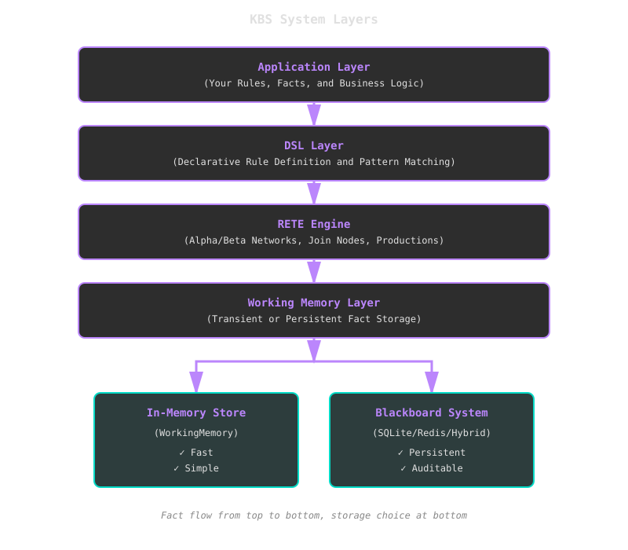
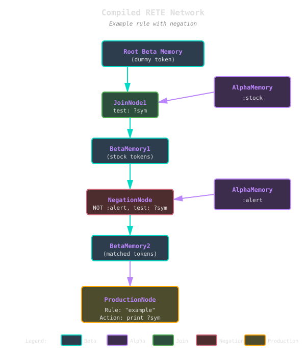

# Architecture Overview

KBS is built on a layered architecture that separates concerns while maintaining high performance.

## System Layers



*KBS uses a layered architecture where facts flow from your application through the DSL, RETE engine, and working memory to one of two storage backends.*

## Core Components

### 1. RETE Engine

The heart of KBS. Implements Charles Forgy's RETE algorithm with modern optimizations.

**Key Files:**
- `lib/kbs/engine.rb` - Main engine coordinator
- `lib/kbs/alpha_network.rb` - Finds a fact's alpha memories by type and constant
- `lib/kbs/alpha_memory.rb` - Pattern-level fact storage
- `lib/kbs/beta_memory.rb` - Token (partial match) storage
- `lib/kbs/join_node.rb` - Inter-condition joins
- `lib/kbs/join_test_builder.rb`, `join_tests.rb` - Compile shared `?variables` into join tests
- `lib/kbs/join_indexing.rb`, `memory_index.rb` - Hash indexes for joins on shared variables
- `lib/kbs/quantifier_node.rb`, `negation_node.rb`, `exists_node.rb` - `without` and `exists` conditions
- `lib/kbs/production_node.rb` - Puts complete matches on the agenda
- `lib/kbs/agenda.rb` - Conflict set of pending activations (priority + strategy)
- `lib/kbs/truth_maintenance.rb` - Logical support for facts asserted under `logical` conditions
- `lib/kbs/fact_registry.rb` - Duplicate fact detection when `fact_duplication: false`
- `lib/kbs/introspection.rb`, `tracer.rb`, `rule_step.rb` - `watch`, `matches`, `join_activity` and `network_stats`

**Responsibilities:**
- Compile rules into discrimination networks
- Propagate fact changes through the network
- Maintain partial matches (tokens)
- Queue complete matches on the agenda and fire them on `run`, until the agenda is empty

**Learn more**: [RETE Algorithm Details](rete-algorithm.md)

### 2. Working Memory

Stores facts and notifies the RETE engine of changes using the Observer pattern.

**Variants:**
- **`WorkingMemory`**: Transient in-memory storage
- **`Blackboard::Memory`**: Persistent storage with audit trails

**Responsibilities:**
- Store facts
- Notify observers when facts are added/removed
- Support queries (`Blackboard::Memory#get_facts` and `#query_facts`)

**Learn more**: [Blackboard Architecture](blackboard.md)

### 3. DSL Layer

Provides a Ruby-native interface for defining rules, conditions, and patterns.

**Key Classes:**
- `KBS.knowledge_base` / `DSL::KnowledgeBase` / `DSL::RuleBuilder` - The `rule ... on ... perform` DSL
- `Rule` - Production rule with conditions and actions
- `Condition` - Pattern specification for fact matching
- `Fact` - Knowledge representation unit

**Example** (the core classes the DSL builds):
```ruby
Rule.new("alert") do |r|
  r.conditions = [
    Condition.new(:sensor, { temp: :t? }),
    Condition.new(:threshold, { max: :max? })
  ]

  r.action = lambda { |facts, bindings|
    puts "Alert!" if bindings[:t?] > bindings[:max?]
  }
end
```

### 4. Blackboard System

Multi-agent collaboration framework with persistent shared memory.

**Components:**
- **Memory** - Central workspace for facts
- **MessageQueue** - Priority-based agent communication
- **AuditLog** - Complete history of changes
- **Persistence** - Pluggable storage backends (SQLite, Redis, Hybrid)

**Use Cases:**
- Multi-agent problem solving
- Audit requirements
- Long-running systems
- Distributed reasoning

**Learn more**: [Blackboard System Details](blackboard.md)

## Data Flow

### Adding a Fact

```
User Code
   │
   ├─→ engine.add_fact(:stock, price: 150)
   │
   ▼
WorkingMemory.add_fact(fact)
   │
   ├─→ @facts << fact
   └─→ notify_observers(:add, fact)
          │
          ▼
       Engine.update(:add, fact)
          │
          └─→ AlphaNetwork.memories_for(fact)
                 (candidates by fact type and constant,
                  then fact.matches?(pattern))
                    │
                    ▼
                 AlphaMemory.activate(fact)
                    │
                    └─→ JoinNode.right_activate(fact)
                           │  (hash-index lookup of tokens
                           │   sharing the ?variable values)
                           └─→ Create tokens, propagate...
                                  │
                                  ▼
                               ProductionNode.activate(token)
                                  │
                                  └─→ agenda.add(activation)
```

### Firing Rules

```
User Code
   │
   ├─→ engine.run(limit = nil)
   │
   ▼
Until halted, limit reached, or agenda empty:
   │
   ├─→ activation = agenda.pop
   │      (highest priority first, then strategy:
   │       :definition, :depth or :breadth)
   │
   └─→ ProductionNode.fire_rule(token)
          │
          ├─→ rule.fire(token.facts)
          │      │
          │      └─→ Extract bindings, execute action
          │             │
          │             └─→ add_fact / remove_fact / modify in the
          │                 action update the agenda before the next pop
          │
          └─→ Mark token as fired
```

## Network Compilation

When you add a rule, KBS compiles it into a discrimination network:

```ruby
rule = Rule.new("example") do |r|
  r.conditions = [
    Condition.new(:stock, { symbol: :sym? }),
    Condition.new(:alert, { symbol: :sym? }, negated: true)
  ]
  r.action = ->(facts, bindings) { puts bindings[:sym?] }
end

engine.add_rule(rule)
```

**Compiled Network:**



*The rule compiles into a network with alpha memories for each condition type, join nodes to combine matches, a negation node for the NOT condition, and a production node that fires when all conditions are satisfied.*

**Learn more**: [Network Structure](network-structure.md)

## Performance Characteristics

| Operation | Complexity | Notes |
|-----------|-----------|-------|
| Add rule | O(C × F) | C = conditions, F = existing facts |
| Add fact | O(N) | N = activated nodes; alpha memories found by type/constant hash, joins on shared `?variables` by hash index |
| Remove fact | O(T) | T = tokens built from the fact (followed by recorded links, no memory scan) |
| Fire rules | O(M) | M = activations; the agenda groups them by salience and rule, as CLIPS does |
| Network sharing | O(1) | Same pattern → same alpha memory |

## Design Principles

### 1. Algorithm Fidelity
Maintain RETE correctness per Forgy's specifications. No shortcuts that break semantics.

### 2. Separation of Concerns
- Engine: Pattern matching
- Memory: Storage
- DSL: User interface
- Blackboard: Collaboration

Each component is independently testable and swappable.

### 3. Performance Through Clarity
Optimize algorithm first (unlinking, network sharing, hash-indexed joins, linked retraction), then profile before micro-optimizations.

### 4. Testability
Every method testable in isolation. Dependency injection for external services.

### 5. Graceful Degradation
Optional features (Redis, AI) don't block core functionality. Fallback to SQLite or in-memory.

### 6. Auditability
Complete audit trails for production systems. Know *why* a rule fired.

## Extension Points

### Custom Persistence

Subclass `KBS::Blackboard::Persistence::Store`:

```ruby
class MyStore < KBS::Blackboard::Persistence::Store
  attr_reader :session_id

  def add_fact(uuid, type, attributes) ... end
  def remove_fact(uuid) ... end        # returns { type:, attributes: } or nil
  def update_fact(uuid, attributes) ... end
  def get_fact(uuid) ... end
  def get_facts(type = nil, pattern = {}) ... end
  def stats ... end
  def close ... end
  # query_facts, clear_session, vacuum, transaction as needed

  # Blackboard::Memory builds its message queue and audit log from
  # either #db (a SQLite3::Database) or #connection (a Redis client);
  # a store with neither raises ArgumentError.
  def db ... end
end

engine = KBS::Blackboard::Engine.new(store: MyStore.new)
```

### Custom Pattern Matching

Subclass `KBS::Fact`, override `matches?`, and have the engine build your
facts by overriding `Engine#create_fact`:

```ruby
class MyFact < KBS::Fact
  def matches?(pattern)
    # Custom matching logic
  end
end

class MyEngine < KBS::Engine
  def create_fact(type, attributes)
    fact = MyFact.new(type, attributes)
    @working_memory.add_fact(fact)
    fact
  end
end
```

`matches?` is only asked about the alpha memories `AlphaNetwork` selects
for the fact: memories of the fact's type, filed under the fact's own value
for a constant-tested attribute. It can narrow a match but cannot make a
fact match a constant it is not equal to; use a Proc in the pattern for that.

### Custom Rule Actions

Actions are lambdas - inject any Ruby code:

```ruby
r.action = lambda do |facts, bindings|
  send_email(bindings[:alert?])
  log_to_database(facts)
  trigger_api_call(bindings)
end
```

## File Organization

```
lib/kbs/
├── engine.rb              # Main engine
├── working_memory.rb      # Fact storage
├── fact.rb                # Fact representation
├── pattern_matching.rb    # Fact#matches?
├── fact_registry.rb       # Duplicate detection
├── truth_maintenance.rb   # Logical support of facts
├── rule.rb                # Rule definition
├── condition.rb           # Pattern specification
├── token.rb               # Partial match
├── alpha_network.rb       # Type/constant discrimination of alpha memories
├── alpha_memory.rb        # Pattern-level cache
├── beta_memory.rb         # Token storage
├── memory_index.rb        # Hash index over a memory
├── join_test_builder.rb   # ?variables → join tests
├── join_tests.rb          # Join test evaluation
├── join_indexing.rb       # Indexed vs residual join tests
├── join_node.rb           # Inter-condition joins
├── quantifier_node.rb     # Base for negation/exists (blocker links)
├── negation_node.rb       # Negated conditions
├── exists_node.rb         # Exists conditions
├── production_node.rb     # Puts matches on the agenda
├── agenda.rb              # Activations and conflict resolution
├── introspection.rb       # watch, matches, join_activity (Engine mixin)
├── tracer.rb              # Writes the watch lines
├── rule_step.rb           # One condition of a rule's network path
├── dsl/                   # KBS.knowledge_base DSL
└── blackboard/            # Persistent memory
    ├── engine.rb          # Blackboard-aware RETE
    ├── memory.rb          # Central workspace
    ├── fact.rb            # Persisted fact
    ├── message_queue.rb   # Agent communication
    ├── audit_log.rb       # Change history
    ├── redis_message_queue.rb
    ├── redis_audit_log.rb
    └── persistence/       # Storage backends
        ├── store.rb       # Abstract interface
        ├── sqlite_store.rb
        ├── redis_store.rb
        └── hybrid_store.rb
```

## Next Steps

- **[RETE Algorithm](rete-algorithm.md)** - Deep dive into pattern matching
- **[Blackboard System](blackboard.md)** - Persistent memory architecture
- **[Network Structure](network-structure.md)** - How rules compile into networks
- **[API Reference](../api/index.md)** - Complete class documentation
