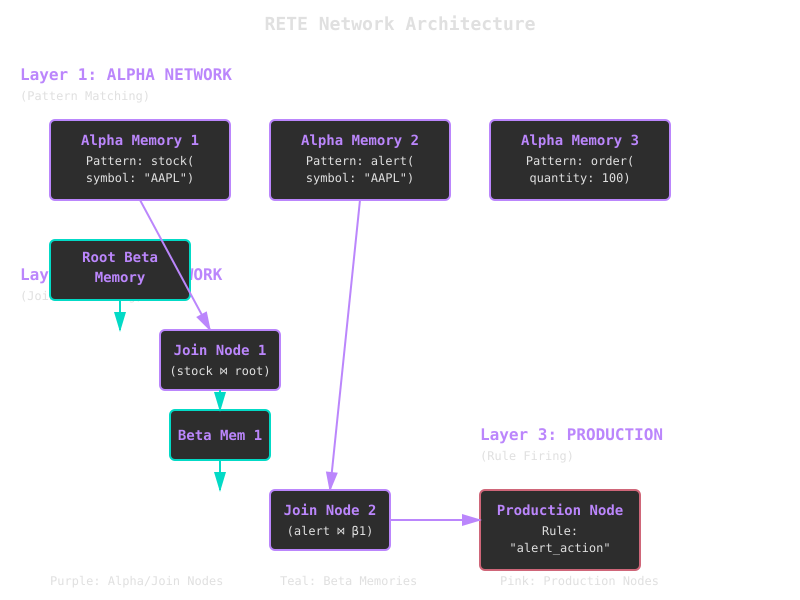
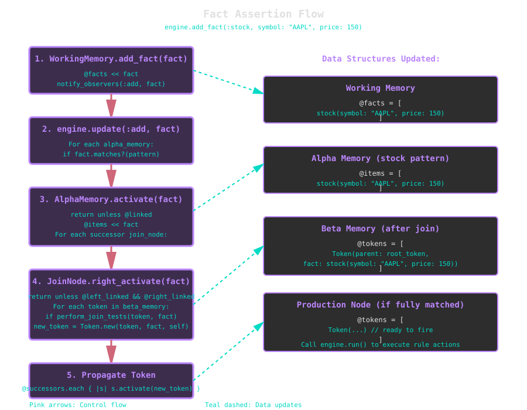
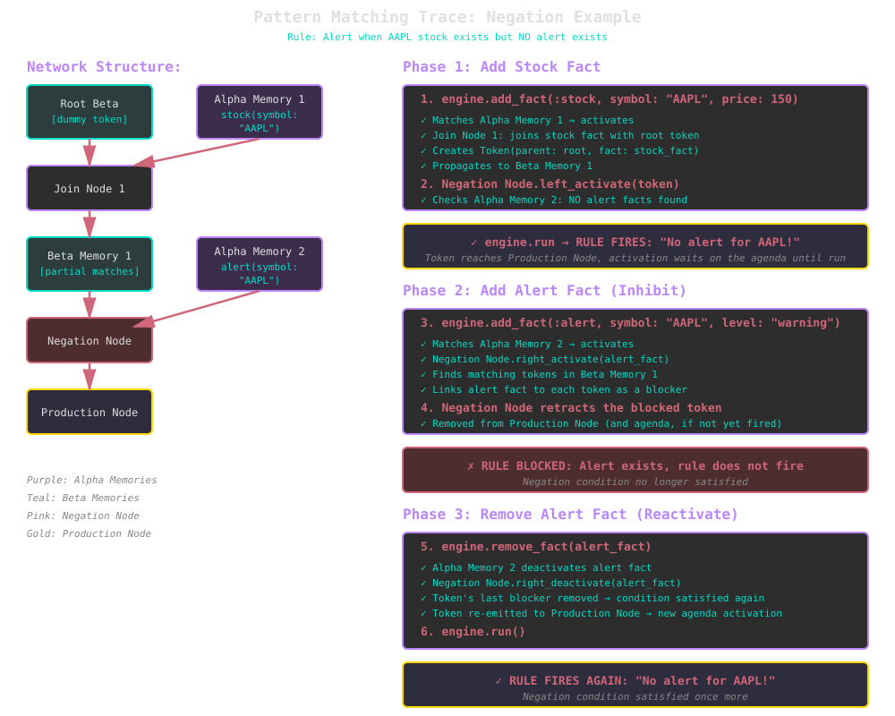

# The RETE Algorithm in KBS

## Overview

The RETE algorithm is a pattern matching algorithm for implementing production rule systems. Developed by Charles Forgy in 1979, RETE (Latin for "network") creates a discrimination network that efficiently matches rules against a working memory of facts. KBS implements the RETE algorithm with left **unlinking** of empty beta memories, hash-indexed joins on shared `?variables`, alpha memories discriminated by fact type and constant, and retraction that follows recorded links instead of scanning memories. Complete matches wait on an **agenda** until `engine.run` fires them.

## Why RETE?

Traditional rule engines evaluate all rules against all facts on every cycle, resulting in O(R × F) complexity where R is the number of rules and F is the number of facts. RETE makes the work per working memory change depend on what that change affects rather than on the total number of rules and facts, by:

1. **Sharing common patterns** across rules in a compiled network
2. **Maintaining state** between cycles (incremental matching)
3. **Processing only changes** rather than re-evaluating everything
4. **Unlinking empty nodes** to skip unnecessary computation (RETE optimization)
5. **Indexing** alpha memories by type and constant, and join memories by shared variable values

## Core Concepts

### Facts

Facts are the fundamental units of knowledge in the system. Each fact has:

- **Type**: A symbol identifying the kind of fact (e.g., `:stock`, `:alert`, `:order`)
- **Attributes**: Key-value pairs containing the fact's data
- **ID**: A unique identifier (object_id for transient facts, UUID for persisted facts)

```ruby
# Creating a fact
fact = engine.add_fact(:stock, symbol: "AAPL", price: 150.0, volume: 1000000)

fact.to_s
# => fact :stock, symbol: "AAPL", price: 150.0, volume: 1000000
```

**Implementation**: `lib/kbs/fact.rb`

### Working Memory

Working memory is the collection of all facts currently known to the system. It implements the **Observer pattern** to notify the RETE network when facts are added or removed.

```ruby
class WorkingMemory
  def add_fact(fact)
    @facts << fact                  # @facts is a Set
    notify_observers(:add, fact)    # Triggers RETE propagation
    fact
  end

  def remove_fact(fact)
    @facts.delete(fact)
    notify_observers(:remove, fact) # Triggers retraction
    fact
  end
end
```

The engine is the observer. `Engine#update` matches the fact (or unmatches it on removal) and raises `KBS::MatchInProgressError` if a fact is added, removed or modified while another fact is still being matched.

**Implementation**: `lib/kbs/working_memory.rb`

### Conditions and Patterns

A condition specifies a pattern that facts must match. Patterns can include:

- **Type matching**: the first argument, `Condition.new(:stock, ...)` (a `type:` key in the pattern is an ordinary attribute named `type`)
- **Literal values**: `{ symbol: "AAPL" }`
- **Variable bindings**: `{ price: :price? }` (variables end with `?`)
- **Predicates**: `{ price: ->(p) { p > 100 } }`
- **Negation**: `negated: true` (match when pattern is absent)
- **Existence**: `exists: true` (match once while at least one fact fits)
- **Logical**: `logical: true` (facts the action asserts depend on this condition staying matched)

```ruby
# Match any stock with symbol "AAPL"
Condition.new(:stock, { symbol: "AAPL" })

# Match stock and bind price to ?price variable
Condition.new(:stock, { symbol: "AAPL", price: :price? })

# Match when there is NO alert for "AAPL"
Condition.new(:alert, { symbol: "AAPL" }, negated: true)
```

**Implementation**: `lib/kbs/condition.rb`

### Rules

Rules are production rules consisting of:

- **Conditions** (IF part): Patterns to match in working memory
- **Action** (THEN part): Code to execute when all conditions match
- **Priority**: Optional integer for conflict resolution (higher fires first)

```ruby
rule = Rule.new("high_price_alert") do |r|
  r.conditions = [
    Condition.new(:stock, { symbol: :symbol?, price: :price? }),
    Condition.new(:threshold, { symbol: :symbol?, max: :max? })
  ]

  r.action = lambda do |facts, bindings|
    if bindings[:price?] > bindings[:max?]
      puts "Alert: #{bindings[:symbol?]} at #{bindings[:price?]}"
    end
  end
end
```

**Implementation**: `lib/kbs/rule.rb`

### Tokens

Tokens represent **partial matches** as they flow through the RETE network. A token is a linked list of facts that have matched conditions so far. Simplified excerpt:

```ruby
class Token
  attr_accessor :parent, :fact, :node

  def initialize(parent, fact, node)
    @parent = parent
    @fact = fact
    @node = node
    @children = nil
    # One slot per condition matched so far (nil for a negated or
    # exists condition), copied from the parent when the token is made
    @slots = parent ? parent.slots + [fact] : (fact ? [fact] : [])
  end

  # The matched facts, one per fact-binding condition
  def facts
    @slots.compact
  end

  # The fact matched by the condition at `index`, used by join tests
  def fact_at(index)
    @slots[index]
  end
end
```

**Key insights**:
- The **root token** has `parent = nil`, `fact = nil` and represents "no conditions matched yet"
- Each join creates a **new token** linking to its parent token plus a new fact
- Tokens form a **tree structure** via `children` (a `Set`, created lazily by `add_child`), so retraction removes a token's descendants without searching

**Implementation**: `lib/kbs/token.rb`

## Network Architecture

The RETE network is a **directed acyclic graph (DAG)** consisting of three layers:



*The three-layer RETE network architecture showing alpha memories (pattern matching), beta network (join processing), and production nodes (rule firing).*

### Layer 1: Alpha Network

The **alpha network** performs **intra-condition** tests - matching individual facts against patterns. Each `AlphaMemory` node:

- Stores facts matching a specific pattern
- Is shared across all rules using the same pattern (network sharing)
- Propagates matches to successor join, negation and exists nodes
- Keeps hash indexes (`index_on`) that join nodes use to look up facts by shared variable values

```ruby
class AlphaMemory
  attr_accessor :successors, :pattern

  def activate(fact)
    return unless @linked
    add_item(fact)                 # adds to @items (a Set) and every index
    @successors.each { |s| s.right_activate(fact) }
  end
end
```

`items` returns a copy of the memory's contents; use `add_item`/`remove_item` to change it.

A new fact does not visit every alpha memory. `KBS::AlphaNetwork#memories_for(fact)` groups the memories by fact type and, within a type, files each memory that tests an attribute against a constant in a hash under that attribute and value. Only the memories found that way, plus those of the type with no constant test, are checked with `Fact#matches?`.

**Example**: If three rules all match `stock(symbol: "AAPL")`, they share one `AlphaMemory` node for that pattern.

**Implementation**: `lib/kbs/alpha_memory.rb`

### Layer 2: Beta Network

The **beta network** performs **inter-condition** tests - joining facts from different conditions. It consists of:

#### Join Nodes

`JoinNode` combines tokens from **beta memory** (left input) with facts from **alpha memory** (right input):

```ruby
class JoinNode
  def left_activate(token)
    return unless @left_linked && @right_linked

    matching_facts(token).each { |fact| emit(token, fact) }
  end

  def right_activate(fact)
    return unless @left_linked && @right_linked

    matching_tokens(fact).each { |token| emit(token, fact) }
  end

  private

  def emit(token, fact)
    new_token = Token.new(token, fact, self)
    token.add_child(new_token)
    remember(new_token)            # @tokens_by_fact[fact], for retraction
    activate_successors(new_token)
  end
end
```

`matching_facts` and `matching_tokens` come from `KBS::JoinIndexing`. The node's equality tests between a token and a fact (what a shared `?variable` compiles to) become the key of a `MemoryIndex` on each memory, so a new fact or token looks up only the entries with the same values. Any remaining ("residual") tests are evaluated on those candidates. A node with no such equality test scans its other memory.

**Join tests** verify:
- Variable consistency (e.g., both conditions match same `:symbol?`), as `:eq` tests
- A variable used twice in one condition (two attributes of the same fact must be equal)

Comparisons other than equality between conditions (e.g., price1 > price2) are not join tests; do them in the action, or in a Proc on a single attribute.

**Implementation**: `lib/kbs/join_node.rb`

#### Beta Memory

`BetaMemory` stores tokens (partial matches) and implements the **unlinking optimization**:

```ruby
class BetaMemory
  def add_token(token)
    @tokens << token
    @indexes.each_value { |index| index.add(token) }
    relink! if @tokens.size == 1  # Relink when first token arrives
  end

  def remove_token(token)
    @tokens.delete(token)
    @indexes.each_value { |index| index.remove(token) }
    @listener&.token_removed(token) # truth maintenance, see below
    unlink! if @tokens.empty?       # Unlink when last token removed
  end
end
```

**Implementation**: `lib/kbs/beta_memory.rb`

#### Negation Nodes

`NegationNode` implements **negated conditions** (e.g., "when there is NO matching fact"). It and `ExistsNode` share their mechanism in `QuantifierNode`, which links each token to the facts that match it (its *blockers*) and each fact to the tokens it matches. Simplified excerpt:

```ruby
class QuantifierNode
  def left_activate(token)
    matching_facts(token).each { |fact| link(token, fact) }
    emit(token) if matched?(token) == passes_when_matched?
  end

  def right_activate(fact)
    matching_tokens(fact).each do |token|
      already_matched = matched?(token)
      link(token, fact)
      next if already_matched

      passes_when_matched? ? emit(token) : retract(token)
    end
  end

  def right_deactivate(fact)
    # Only the tokens this fact was linked to are visited
    (@tokens_matched_by.delete(fact) || []).each do |token|
      facts = @facts_matching[token]
      facts.delete(fact)
      next unless facts.empty?

      @facts_matching.delete(token)
      passes_when_matched? ? retract(token) : emit(token)
    end
  end
end

class NegationNode < QuantifierNode
  def passes_when_matched? = false   # pass while no fact matches
end

class ExistsNode < QuantifierNode
  def passes_when_matched? = true    # pass once while any fact matches
end
```

**Key insight**: Negation and exists nodes propagate tokens with `fact = nil` since there's no actual fact to include. An exists condition passes a token once, however many facts match, and binds no variables for later conditions.

**Implementation**: `lib/kbs/quantifier_node.rb`, `lib/kbs/negation_node.rb`, `lib/kbs/exists_node.rb`

### Layer 3: Production Nodes

`ProductionNode` is the terminal node for each rule. When a token reaches a production node, all rule conditions have been satisfied:

```ruby
class ProductionNode
  def activate(token)
    @tokens << token
    # Don't fire immediately - put an activation on the agenda
    @activations[token] = @agenda.add(self, token, rule_order: @order) if @agenda
  end

  def deactivate(token)
    @tokens.delete(token)
    @agenda&.remove(@activations.delete(token))  # cancel if not yet fired
  end

  def fire_rule(token)
    return if token.fired?
    @rule.fire(token.facts)
    token.mark_fired!
  end
end
```

**Why delay firing?** Negation nodes, retractions and other rules' actions may need to **deactivate** tokens after they're created but before they fire. Waiting on the agenda lets a later retraction cancel the activation.

**Implementation**: `lib/kbs/production_node.rb`

## The RETE Cycle

### 1. Network Construction

When a rule is added via `engine.add_rule(rule)`, the network is built:

```ruby
def build_network_for_rule(rule)
  conditions = rule.conditions
  # Compile shared ?variables into per-condition join tests
  join_tests = JoinTestBuilder.new(conditions).tests
  last_logical = rule.logical_count - 1

  beta_memory = @root_beta_memory
  conditions.each_with_index do |condition, index|
    beta_memory = add_condition_node(beta_memory, condition, join_tests[index])
    # The memory after the last logical condition reports removed
    # tokens to the engine (truth maintenance)
    beta_memory.listener = self if index == last_logical
  end
  add_production_node(rule, beta_memory)
end

def add_condition_node(beta_memory, condition, tests)
  # Create or reuse alpha memory
  alpha_memory = get_or_create_alpha_memory(condition.pattern.merge(type: condition.type))
  # JoinNode, NegationNode or ExistsNode
  node = node_class_for(condition).new(alpha_memory, beta_memory, tests)
  new_beta = BetaMemory.new
  node.successors << new_beta
  replay_tokens(beta_memory, node)   # bring the new node up to date
  new_beta
end

def add_production_node(rule, beta_memory)
  node = ProductionNode.new(rule, @agenda, order: @rules.size)
  beta_memory.successors << node
  @production_nodes[rule.name] = node
  replay_tokens(beta_memory, node) unless rule.conditions.empty?
end
```

Because new alpha memories are seeded from working memory and existing tokens are replayed into each new node, a rule added after facts are asserted matches those facts.

**Implementation**: `KBS::Engine#build_network_for_rule` in `lib/kbs/engine.rb`

### 2. Fact Assertion

When `engine.add_fact(:stock, symbol: "AAPL", price: 150)` is called:



*Step-by-step flow showing how a fact propagates through the RETE network from working memory to production nodes. Step 4's hash-index lookup applies when the condition shares a `?variable` with an earlier one. A token reaching the production node becomes an activation on the agenda.*

### 3. Pattern Matching Flow

Let's trace a fact through the network for this rule:

```ruby
# Rule: Alert when AAPL stock exists but no alert exists
rule = Rule.new("no_alert") do |r|
  r.conditions = [
    Condition.new(:stock, { symbol: "AAPL" }),
    Condition.new(:alert, { symbol: "AAPL" }, negated: true)
  ]
  r.action = ->(facts) { puts "No alert for AAPL!" }
end
```



*Complete trace showing how negation works: adding a stock fact activates the rule, adding an alert inhibits it, and removing the alert reactivates the rule. A match puts an activation on the agenda; the action runs on `engine.run()`. If the alert arrives before `run`, the pending activation is cancelled and the rule does not fire for it.*

### 4. Rule Execution

The final phase is `engine.run()`:

```ruby
def run(limit = nil)
  @halted = false
  fired = 0

  until @halted || (limit && fired >= limit)
    activation = @agenda.pop
    break unless activation

    fire_activation(activation)
    fired += 1
  end

  fired
end
```

A production node does not fire when a token reaches it. It puts an *activation* on the agenda (`KBS::Agenda`), and takes it off again if the token is retracted before it fires. `run` pops one activation at a time: higher rule priority first, then the agenda's strategy (`:definition`, `:depth` or `:breadth`). Because the agenda is read again after every firing, facts asserted by one rule can fire another in the same run, and the run ends when the agenda is empty. Popping removes the activation, so a match fires once.

**Implementation**: `KBS::Engine#run` in `lib/kbs/engine.rb`

## RETE Optimization: Unlinking

### The Problem

In basic RETE, join nodes always process activations even when one input is empty:

```
BetaMemory (0 tokens) ──┐
                        ├──→ JoinNode ──→ (does useless work!)
AlphaMemory (100 facts) ┘
```

If beta memory is empty, the join will produce zero results, wasting CPU cycles.

### The Solution

RETE introduces **dynamic unlinking**: nodes disconnect from the network when an input is empty and reconnect when it is non-empty. In KBS a beta memory does this automatically (left unlinking). `AlphaMemory#unlink!`/`#relink!` exist for right unlinking, but the engine does not call them.

```ruby
class BetaMemory
  def add_token(token)
    @tokens << token
    relink! if @tokens.size == 1  # Reconnect when first token arrives
  end

  def remove_token(token)
    @tokens.delete(token)
    unlink! if @tokens.empty?     # Disconnect when empty
  end

  def relink!
    @linked = true
    @successors.each { |s| s.left_relink! }
  end

  def unlink!
    @linked = false
    @successors.each { |s| s.left_unlink! }
  end
end
```

**Join node respects linking state**:

```ruby
class JoinNode
  def left_activate(token)
    return unless @left_linked && @right_linked  # Skip if unlinked!
    # ... perform join ...
  end

  def right_activate(fact)
    return unless @left_linked && @right_linked  # Skip if unlinked!
    # ... perform join ...
  end
end
```

### Performance Impact

For rules with many conditions, unlinking can avoid a large share of useless join activations (the saving depends on the rule set; KBS ships no benchmark for it):

- Empty beta memories don't process fact assertions: a fact arriving at a join node whose beta memory is empty returns at once
- An empty alpha memory gives a left activation nothing to join with
- Network "lights up" only the relevant paths

This matters most for:
- **Rare patterns** (e.g., "critical alert" facts) early in a rule
- **Complex rules** (many conditions = more opportunities for empty nodes)

Negation and exists nodes do not use the linking flags; they rely on their blocker links instead.

## Variable Binding

Variables (symbols ending with `?`) enable cross-condition constraints and action parameterization:

### Extraction During Network Build

```ruby
class Condition
  def extract_variables(pattern)
    vars = {}
    pattern.each do |key, value|
      if value.is_a?(Symbol) && value.to_s.end_with?('?')
        vars[value] = key  # { :symbol? => :symbol, :price? => :price }
      end
    end
    vars
  end
end
```

**Implementation**: `Condition#extract_variables` in `lib/kbs/condition.rb`

### Join Test Generation

`KBS::JoinTestBuilder` turns variables into **join tests** to ensure consistency. A variable first bound by a positive condition becomes an equality test in each later condition that uses it; a variable that first appears in a negated or exists condition is local to that condition.

```ruby
# Rule with shared ?symbol variable
conditions = [
  Condition.new(:stock, { symbol: :symbol?, price: :price? }),
  Condition.new(:order, { symbol: :symbol?, quantity: 100 })
]

KBS::JoinTestBuilder.new(conditions).tests
# => [
#   [],                          # stock: nothing to join with
#   [{
#     token_field_index: 0,      # Fact matched by condition 0 (stock)
#     token_field: :symbol,      # Get its :symbol attribute
#     fact_field: :symbol,       # Compare with order's :symbol attribute
#     operation: :eq             # Must be equal
#   }]
# ]
# quantity: 100 is a constant, tested by the alpha memory, not a join test
```

**Implementation**: `lib/kbs/join_test_builder.rb` (evaluation in `lib/kbs/join_tests.rb`)

### Action Binding

When a rule fires, bindings are extracted for the action:

```ruby
def fire(facts)
  @fired_count += 1
  return unless @action

  bindings = bindings_for(facts)
  # bindings = { :symbol? => "AAPL", :price? => 150.0 }

  # Actions may take 0, 1 (facts) or 2 (facts, bindings) parameters
  if @action.arity.zero?
    @action.call
  elsif [1, -1].include?(@action.arity)
    @action.call(facts)
  else
    @action.call(facts, bindings)
  end
end

def bindings_for(facts)
  # Facts line up with the conditions that bind a fact; negated and
  # exists conditions contribute none
  @conditions.select(&:binds_fact?).zip(facts).each_with_object({}) do |(condition, fact), bindings|
    bindings.merge!(condition.bindings_from(fact)) if fact
  end
end
```

**Implementation**: `Rule#fire` and `Rule#bindings_for` in `lib/kbs/rule.rb`

## Advanced Topics

### Conflict Resolution

When multiple rules are activated simultaneously, KBS uses **priority** (higher values fire first):

```ruby
rule1 = Rule.new("urgent", priority: 10) { ... }
rule2 = Rule.new("normal", priority: 0) { ... }

# rule1 fires before rule2
```

With the default `:definition` strategy, rules with the same priority fire in the order they were defined, and each rule's activations oldest first. `KBS::Engine.new(strategy: :depth)` fires the newest activation first and `:breadth` the oldest; `engine.strategy = ...` changes it later. `engine.run(limit)` stops after `limit` firings, and `engine.halt` (called from an action) stops the run after the current rule.

### Fact Retraction

Removing a fact follows links recorded when it was matched, so no memory is scanned. The engine remembers which alpha memories each fact entered and deactivates exactly those; each join node remembers the tokens it built from each fact:

```ruby
class JoinNode
  def right_deactivate(fact)
    tokens_for(@tokens_by_fact.delete(fact)).each do |child|
      child.parent&.remove_child(child)
      deactivate_successors(child)   # Recursive: beta memory → next nodes
    end
  end
end
```

Removing a token from a beta memory deactivates the tokens built from it downstream, and a token reaching a production node cancels its pending activation. Removing a fact therefore withdraws every **match** that used it.

It does not, by itself, retract facts that a rule's action asserted from that match. For that, put the conditions in a `logical` block (or `Condition.new(..., logical: true)`); `KBS::TruthMaintenance` then records which match supports each asserted fact and retracts the fact when its last support goes away. `engine.logically_supported?(fact)`, `engine.dependencies(fact)` and `engine.dependents(fact)` expose those links.

**Implementation**: `JoinNode#right_deactivate` in `lib/kbs/join_node.rb`, `lib/kbs/truth_maintenance.rb`

### Network Sharing

Alpha memories are **shared across rules** using the pattern (including its type) as the hash key:

```ruby
def get_or_create_alpha_memory(pattern)
  # AlphaNetwork#fetch: memories[pattern] ||= a new, filed AlphaMemory,
  # seeded with the matching facts already in working memory
  @alpha_network.fetch(pattern) { |memory| seed_alpha_memory(memory, pattern) }
end
```

The key is the whole pattern, variable names included: `{ price: :p? }` and `{ price: :price? }` get separate memories. Join nodes and beta memories are not shared; each rule has its own.

If 10 rules all match `stock(symbol: "AAPL")`, they share one `AlphaMemory` node, reducing:
- Memory usage (one fact store instead of 10)
- Computation (one pattern match instead of 10)

**Implementation**: `KBS::Engine#get_or_create_alpha_memory` in `lib/kbs/engine.rb`

### Incremental Matching

RETE is **incremental**: after the initial network build, only changes are processed. Adding a fact activates a small subgraph, not the entire network.

**Complexity**:
- Initial build: O(R × F) where R = rules, F = facts
- Per-fact addition: O(N) where N = activated nodes (typically << R × F)
- Per-fact removal: O(T) where T = tokens to remove

`benchmarks/rete_scaling.rb` measures this: with hash-indexed joins and linked retraction, the per-fact rate stays roughly flat from 500 to 2000 facts (see [Performance Tuning](../advanced/performance.md#rete-scaling)).

## Debugging RETE Networks

### Visualizing Token Flow

`Token#to_s` already prints `Token(<facts>)`, and each pending activation prints as `"<priority> <rule>: <facts>"`:

```ruby
# Pending activations, in firing order
engine.agenda.to_a.each { |activation| puts activation }

# In your rule action:
r.action = lambda do |facts, bindings|
  puts "Fired with facts: #{facts.map(&:to_s).join(', ')}"
  puts "Bindings: #{bindings.inspect}"
end
```

### Inspecting Network State

Check what's in memories:

```ruby
# Alpha memory contents
engine.alpha_memories.each do |pattern, memory|
  puts "Pattern #{pattern}: #{memory.items.size} facts"
  memory.items.each { |f| puts "  - #{f}" }
end

# Beta memory contents: start from a node and walk down
# (node → beta memory → next node ... → production node)
def walk_beta_network(node, depth = 0)
  indent = '  ' * depth
  if node.is_a?(KBS::ProductionNode)
    return puts "#{indent}Production #{node.rule.name}: #{node.tokens.size} matches"
  end

  node.successors.grep(KBS::BetaMemory).each do |beta|
    puts "#{indent}Beta memory: #{beta.tokens.size} tokens"
    beta.tokens.each { |t| puts "#{indent}  - #{t}" }
    beta.successors.each { |next_node| walk_beta_network(next_node, depth + 1) }
  end
end

# First-condition nodes are the successors of the alpha memories
first_memory = engine.alpha_memories.values.first
first_memory.successors.each { |node| walk_beta_network(node) }
```

### Common Pitfalls

1. **Forgetting to call `engine.run()`**: Activations wait on the agenda but rules don't fire
2. **Pattern mismatches**: the fact type is the first argument, `Condition.new(:stock, {})`, and that condition matches every `:stock` fact. A `type:` key in the pattern tests an attribute named `:type`, not the fact type
3. **Variable binding errors**: Using `?symbol` (string) instead of `:symbol?` (symbol)
4. **Negation timing**: Removing the last fact that blocks a negated condition puts the rule back on the agenda; it fires on the next `engine.run()`. Adding a blocking fact before `run` cancels a pending activation
5. **Predicates see values once**: a Proc in a pattern runs when the fact is asserted (or modified with `engine.modify`), not on every `run`, so a time-based predicate such as "older than 5 minutes" does not become true later on its own

## Performance Characteristics

### Time Complexity

| Operation | Complexity | Notes |
|-----------|-----------|-------|
| Add rule | O(C × F) | C = conditions, F = existing facts |
| Add fact | O(N) | N = activated nodes (avg << total nodes) |
| Remove fact | O(T) | T = tokens containing fact (found by recorded links) |
| Run rules | O(M log M) | M = activations on the agenda (binary heap) |

### Space Complexity

| Structure | Space | Notes |
|-----------|-------|-------|
| Alpha memories | O(F × P) | F = facts, P = unique patterns |
| Beta memories | O(T) | T = partial match tokens |
| Tokens | O(C × M) | C = conditions, M = complete matches |
| Network nodes | O(R × C) | R = rules, C = avg conditions per rule |

### Optimization Strategies

1. **Pattern specificity**: Put most selective conditions first to reduce beta memory size
2. **Negation placement**: Place negated conditions after the conditions that bind their variables (they don't add facts to tokens)
3. **Shared patterns**: Design rules to share common patterns
4. **Shared variables on joins**: equality on a shared `?variable` is hash-indexed; joins without one scan the other memory
5. **Constants in patterns**: a constant test lets `AlphaNetwork` find the memory by hash; predicate-only patterns are tested for every fact of the type
6. **Fact pruning**: Remove obsolete facts to trigger unlinking
7. **Priority tuning**: Use priority to fire expensive rules last

## Comparison with Other Algorithms

### Naive Match-All

```ruby
# O(R × F) on every cycle
def naive_fire_rules
  rules.each do |rule|
    facts.each do |fact|
      if rule.matches?(fact)
        rule.fire(fact)
      end
    end
  end
end
```

**Problem**: Re-evaluates everything, no state preservation.

### TREAT

TREAT eliminates alpha/beta network in favor of lazy evaluation:
- **Pros**: Simpler implementation, lower memory
- **Cons**: Slower for rules that fire frequently (no memoization)

RETE is better when rules fire often; TREAT is better for sparse firing.

### Basic RETE vs RETE with Unlinking

Early RETE implementations lacked unlinking:
- **Without unlinking**: All nodes always active, many wasted join operations
- **With unlinking**: Nodes disconnect when empty, skipping those join operations

KBS implements RETE with (left) unlinking.

## Implementation Files

| Component | File | Lines |
|-----------|------|-------|
| Core engine | `lib/kbs/engine.rb` | ~440 |
| Agenda | `lib/kbs/agenda.rb` | ~195 |
| Working memory | `lib/kbs/working_memory.rb` | ~55 |
| Facts | `lib/kbs/fact.rb`, `pattern_matching.rb` | ~55 |
| Fact registry | `lib/kbs/fact_registry.rb` | ~50 |
| Truth maintenance | `lib/kbs/truth_maintenance.rb` | ~80 |
| Tokens | `lib/kbs/token.rb` | ~85 |
| Alpha network | `lib/kbs/alpha_network.rb` | ~85 |
| Alpha memory | `lib/kbs/alpha_memory.rb` | ~85 |
| Beta memory | `lib/kbs/beta_memory.rb` | ~90 |
| Memory index | `lib/kbs/memory_index.rb` | ~75 |
| Join tests | `lib/kbs/join_test_builder.rb`, `join_tests.rb`, `join_indexing.rb` | ~220 |
| Join nodes | `lib/kbs/join_node.rb` | ~155 |
| Negation/exists nodes | `lib/kbs/quantifier_node.rb`, `negation_node.rb`, `exists_node.rb` | ~165 |
| Production nodes | `lib/kbs/production_node.rb` | ~60 |
| Network node | `lib/kbs/network_node.rb` | ~30 |
| Conditions | `lib/kbs/condition.rb` | ~65 |
| Rules | `lib/kbs/rule.rb` | ~60 |

**Total**: ~2,000 lines of core RETE implementation.

## Further Reading

### Academic Papers

- Forgy, C. (1982). "Rete: A Fast Algorithm for the Many Pattern/Many Object Pattern Match Problem". *Artificial Intelligence*, 19(1), 17-37.
- Forgy, C. (1989). "Rete: A Fast Match Algorithm". *AI Expert*, 4(1), 34-40.

### Textbooks

- Giarratano, J., & Riley, G. (2004). *Expert Systems: Principles and Programming* (4th ed.). Course Technology.
- Russell, S., & Norvig, P. (2020). *Artificial Intelligence: A Modern Approach* (4th ed.). Pearson. (Chapter on Rule-Based Systems)

### Online Resources

- [RETE Algorithm Visualization](http://www.jessrules.com/docs/71/rete.html) - Jess documentation
- [Production Systems](https://en.wikipedia.org/wiki/Production_system_(computer_science)) - Wikipedia
- [Rule-Based Expert Systems](https://www.cs.toronto.edu/~hector/PublicKnowledgeBase.html) - University of Toronto

## Next Steps

- **[DSL Guide](../guides/dsl.md)**: Learn how to write rules using KBS's Ruby DSL
- **[Blackboard Architecture](blackboard.md)**: Understand persistent memory and multi-agent systems
- **[Examples](../examples/index.md)**: See RETE in action with stock trading and expert systems
- **[Performance Tuning](../advanced/performance.md)**: Optimize your rule-based system
