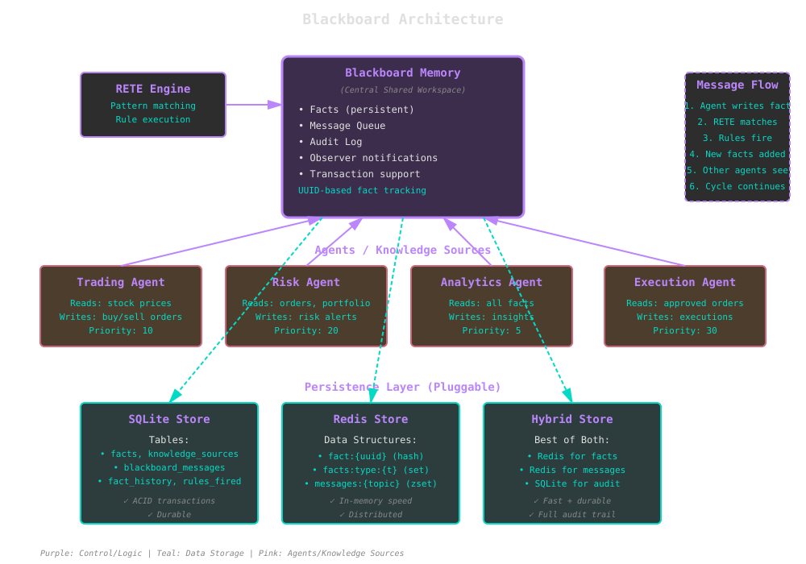

# Blackboard Memory

The blackboard pattern enables multiple agents to collaborate through a shared persistent workspace. This guide covers using KBS's blackboard memory for multi-agent systems, audit trails, and persistent knowledge bases.

## What is Blackboard Memory?

The blackboard architecture consists of three components:

1. **Blackboard** (`KBS::Blackboard::Memory`) - Central shared workspace
2. **Knowledge Sources** (Agents) - Independent specialists that read/write facts
3. **Control** (Rules + Priority) - Determines which agent acts when



*KBS uses the blackboard pattern for persistent, multi-agent reasoning with complete audit trails.*

## Basic Usage

### Creating a Blackboard Engine

```ruby
require 'kbs'
require 'kbs/blackboard'  # not loaded by require 'kbs'

# With SQLite (default)
engine = KBS::Blackboard::Engine.new(db_path: 'kb.db')

kb = KBS.knowledge_base(engine: engine) do
  # Facts persist across restarts
  fact :sensor, id: "bedroom", temp: 28
end

kb.close

# Next run
engine = KBS::Blackboard::Engine.new(db_path: 'kb.db')
kb = KBS.knowledge_base(engine: engine)
puts kb.engine.facts.size  # => 1
```

### Blackboard vs Regular Engine

```ruby
# Regular engine (transient)
kb_regular = KBS.knowledge_base do
  fact :foo, bar: 1
end
# Lost on exit

# Blackboard engine (persistent)
engine = KBS::Blackboard::Engine.new(db_path: 'kb.db')
kb_blackboard = KBS.knowledge_base(engine: engine) do
  fact :foo, bar: 1
end
kb_blackboard.close
# Persisted to database
```

## Persistent Facts

### Fact Lifecycle

```ruby
engine = KBS::Blackboard::Engine.new(db_path: 'kb.db')

# Create fact
fact = engine.add_fact(:sensor, id: "bedroom", temp: 28)

# Fact has UUID
puts fact.uuid  # => "550e8400-e29b-41d4-a716-446655440000"

# Update fact (keeps the UUID, re-matches the rules)
fact = engine.modify(fact, temp: 30)

# Query fact history (newest first)
history = engine.blackboard.get_history(fact.uuid)
history.each do |entry|
  puts "#{entry[:timestamp]}: #{entry[:action]} - #{entry[:attributes]}"
end

# Retract fact (marked retracted in the database)
engine.remove_fact(fact)
```

### Fact Attributes

Blackboard facts support the same interface as regular facts:

```ruby
engine = KBS::Blackboard::Engine.new(db_path: 'kb.db')
fact = engine.add_fact(:stock, symbol: "AAPL", price: 150)

# Access
fact.type           # => :stock
fact[:symbol]       # => "AAPL"
fact.attributes     # => { symbol: "AAPL", price: 150 }
fact.uuid           # => UUID string

# As a hash
fact.to_h           # => { uuid: "...", type: :stock, attributes: { symbol: "AAPL", price: 150 } }
```

Attributes are stored as JSON. Facts read back from the store (`engine.facts`, or after a restart) have Symbol and Time values turned into Strings, so store timestamps as numbers (`Time.now.to_f`) if rules compare them.

## Message Queue

The blackboard includes a priority-based message queue for agent communication:

### Sending Messages

```ruby
engine = KBS::Blackboard::Engine.new(db_path: 'kb.db')

# Add message to queue: sender, topic, content
engine.post_message("monitor", "alerts", "High temperature detected", priority: 10)
engine.post_message("monitor", "alerts", "Critical failure", priority: 100)  # Higher priority
```

Use Strings for sender and topic; the SQLite queue cannot store Symbols. Content may be a String or anything JSON can encode.

### Receiving Messages

```ruby
# Take the highest priority message, recording who consumed it
msg = engine.consume_message("alerts", "alert_agent")
puts msg[:content]   # => "Critical failure"
puts msg[:priority]  # => 100

# Process all messages
while (msg = engine.consume_message("alerts", "alert_agent"))
  process_alert(msg[:content])
end

# Look without consuming
engine.blackboard.peek_messages("alerts", limit: 5)
```

### Message Topics

Organize messages by topic:

```ruby
# Different topics for different concerns
engine.post_message("sensors", "sensor_alerts", "Temp spike", priority: 50)
engine.post_message("system", "system_events", "Startup complete", priority: 10)
engine.post_message("ui", "user_notifications", "Welcome!", priority: 1)

# Agents process their own topics
sensor_agent_msg = engine.consume_message("sensor_alerts", "sensor_agent")
system_msg = engine.consume_message("system_events", "system_agent")
user_msg = engine.consume_message("user_notifications", "ui_agent")
```

## Audit Trail

Blackboard automatically logs all changes:

### Fact Audit Log

```ruby
engine = KBS::Blackboard::Engine.new(db_path: 'kb.db')

# Add fact
fact = engine.add_fact(:order, id: 1, status: "pending")

# Update fact
engine.modify(fact, status: "processing")

# Retract fact
engine.remove_fact(fact)

# Query audit trail (newest first)
history = engine.blackboard.get_history(fact.uuid)
history.each do |entry|
  puts "#{entry[:timestamp]}: #{entry[:action]}"
  puts "  Attributes: #{entry[:attributes]}"
end

# Output:
# 2025-01-15 10:02:00 -0600: REMOVE
#   Attributes: {id: 1, status: "processing"}
# 2025-01-15 10:01:00 -0600: UPDATE
#   Attributes: {id: 1, status: "processing"}
# 2025-01-15 10:00:00 -0600: ADD
#   Attributes: {id: 1, status: "pending"}
```

### Rule Firing Log

Every rule firing is logged; there is nothing to enable:

```ruby
engine = KBS::Blackboard::Engine.new(db_path: 'kb.db')

kb = KBS.knowledge_base(engine: engine) do
  rule "my_rule" do
    on :trigger, {}
    perform { }
  end

  fact :trigger, {}
  run
end

# Query rule firings
firings = engine.blackboard.get_rule_firings("my_rule")
firings.each do |firing|
  puts "Rule '#{firing[:rule_name]}' fired at #{firing[:fired_at]}"
  puts "  Facts: #{firing[:fact_uuids]}"
  puts "  Bindings: #{firing[:bindings]}"
end
```

## Multi-Agent Systems

### Agent Pattern

```ruby
class Agent
  def initialize(name, engine)
    @name = name
    @engine = engine
  end

  def observe
    # Read facts from blackboard
    @engine.facts.select { |f| relevant?(f) }
  end

  def decide(observations)
    # Apply agent's expertise
    # Return action or nil
  end

  def act(action)
    # Write facts to blackboard
    # Send messages to other agents
  end

  def run
    observations = observe
    action = decide(observations)
    act(action) if action
  end
end
```

### Example: Trading System

```ruby
class MarketDataAgent < Agent
  def run
    # Fetch market data
    data = fetch_market_data()

    # Post to blackboard
    @engine.add_fact(:market_data, {
      symbol: data[:symbol],
      price: data[:price],
      volume: data[:volume],
      timestamp: Time.now.to_f
    })
  end
end

class TradingAgent < Agent
  def run
    # Observe market data
    market_facts = @engine.facts.select { |f| f.type == :market_data }

    market_facts.each do |fact|
      # Apply trading strategy
      if buy_signal?(fact)
        @engine.add_fact(:order, {
          symbol: fact[:symbol],
          type: "buy",
          quantity: calculate_quantity(fact),
          price: fact[:price]
        })

        @engine.post_message(@name, "execution", "New buy order", priority: 50)
      end
    end
  end

  def buy_signal?(fact)
    # Agent's expertise
    fact[:price] < moving_average(fact[:symbol]) * 0.95
  end
end

class ExecutionAgent < Agent
  def run
    # Check for execution messages
    while (msg = @engine.consume_message("execution", @name))
      # Find pending orders
      orders = @engine.facts.select { |f|
        f.type == :order && !f[:executed]
      }

      orders.each do |order|
        execute_order(order)

        # Update fact
        @engine.modify(order, executed: true)

        # Notify
        @engine.post_message(@name, "notifications", "Order executed", priority: 10)
      end
    end
  end
end

# Run agents in loop
engine = KBS::Blackboard::Engine.new(db_path: 'trading.db')

market_agent = MarketDataAgent.new("Market", engine)
trading_agent = TradingAgent.new("Trading", engine)
execution_agent = ExecutionAgent.new("Execution", engine)

loop do
  market_agent.run      # Fetch data → blackboard
  trading_agent.run     # Analyze → create orders
  execution_agent.run   # Execute orders
  sleep 1
end
```

## Transactions

The blackboard memory supports transactions (SQLite backend):

```ruby
engine = KBS::Blackboard::Engine.new(db_path: 'kb.db')

# Transaction succeeds
engine.blackboard.transaction do
  engine.add_fact(:account, id: 1, balance: 1000)
  engine.add_fact(:account, id: 2, balance: 500)
end
# Both facts committed

# Transaction fails
begin
  engine.blackboard.transaction do
    engine.add_fact(:account, id: 3, balance: 100)
    raise "Error!"
    engine.add_fact(:account, id: 4, balance: 200)  # Never reached
  end
rescue => e
  puts "Transaction rolled back"
end
# No facts committed
```

A rollback undoes the database writes only. Facts added inside the block were already matched by the rules, so they stay in the RETE network and can still fire. The Redis and hybrid stores do not roll back.

## Observers

Monitor blackboard changes in real-time:

```ruby
class FactObserver
  def update(operation, fact)
    case operation
    when :add
      puts "Fact added: #{fact.type} - #{fact.attributes}"
    when :remove
      puts "Fact removed: #{fact.type} - #{fact.attributes}"
    end
  end
end

engine = KBS::Blackboard::Engine.new(db_path: 'kb.db')
observer = FactObserver.new
engine.blackboard.add_observer(observer)

engine.add_fact(:sensor, temp: 28)
# Output: Fact added: sensor - {temp: 28}
```

Observers see only `:add` and `:remove`. `engine.modify` reports a `:remove` followed by an `:add`; `fact.update` and `fact[:key] = value` write to the store without notifying observers.

## Performance Tuning

### SQLite Optimization

The engine takes only `db_path:` or `store:` for storage. Tune SQLite through the store's `SQLite3::Database`:

```ruby
engine = KBS::Blackboard::Engine.new(db_path: 'kb.db')
db = engine.blackboard.store.db

db.execute("PRAGMA journal_mode = WAL")      # Write-Ahead Logging
db.execute("PRAGMA synchronous = NORMAL")    # Balance durability/speed
db.execute("PRAGMA cache_size = -64000")     # 64MB cache
db.busy_timeout = 5000                        # Wait 5s for locks
```

### Redis for Speed

```ruby
require 'kbs/blackboard'  # loads every store; Redis needs the redis gem

store = KBS::Blackboard::Persistence::RedisStore.new(
  url: 'redis://localhost:6379/0'
)

engine = KBS::Blackboard::Engine.new(store: store)

# Facts, messages and the audit log all in Redis
# Suited to high-frequency updates
```

### Hybrid for Production

```ruby
require 'kbs/blackboard'

store = KBS::Blackboard::Persistence::HybridStore.new(
  redis_url: 'redis://localhost:6379/0',
  db_path: 'audit.db'
)

engine = KBS::Blackboard::Engine.new(store: store)

# Facts and messages in Redis + durable audit log in SQLite
```

## Best Practices

### 1. Use UUIDs for Fact References

```ruby
# Good: Store fact UUID
order_id = engine.add_fact(:order, { ... }).uuid
engine.add_fact(:payment, order_id: order_id)

# Bad: Use attribute as reference
engine.add_fact(:order, id: 1)
engine.add_fact(:payment, order_id: 1)  # Fragile
```

### 2. Namespace Facts by Agent

```ruby
# Good: Clear ownership
engine.add_fact(:market_agent_data, { ... })
engine.add_fact(:trading_agent_signal, { ... })

# Bad: Generic names
engine.add_fact(:data, { ... })
engine.add_fact(:signal, { ... })
```

### 3. Use Messages for Coordination

```ruby
# Good: Explicit coordination
engine.post_message("orders", "execution_queue", "Process order #123", priority: 50)

# Bad: Polling facts
loop do
  orders = engine.facts.select { |f| f.type == :pending_order }
  # Inefficient
end
```

### 4. Clean Up Old Facts

```ruby
# Remove stale data
engine = KBS::Blackboard::Engine.new(db_path: 'kb.db')

kb = KBS.knowledge_base(engine: engine) do
  rule "cleanup_old_facts", priority: 1 do
    # timestamp stored as Time.now.to_f
    on :market_data,
      timestamp: ->(t) { Time.now.to_f - t > 3600 }  # 1 hour old

    perform do |facts, bindings|
      engine.remove_fact(facts[0])
    end
  end
end
```

### 5. Use Transactions for Multi-Fact Updates

```ruby
engine = KBS::Blackboard::Engine.new(db_path: 'kb.db')

# Good: Atomic updates
engine.blackboard.transaction do
  engine.modify(account1, balance: new_balance1)
  engine.modify(account2, balance: new_balance2)
end

# Bad: Separate updates (not atomic)
engine.modify(account1, balance: new_balance1)
engine.modify(account2, balance: new_balance2)
```

## Common Patterns

### Leader Election

```ruby
engine = KBS::Blackboard::Engine.new(db_path: 'kb.db')

kb = KBS.knowledge_base(engine: engine) do
  # Agent attempts to become leader
  rule "become_leader" do
    on :agent, name: :name?
    without :leader, {}

    # self is the rule builder here, so assert through kb
    perform do |facts, bindings|
      kb.fact :leader, name: bindings[:name?]
      puts "#{bindings[:name?]} is now leader"
    end
  end
end
```

### Distributed Locking

```ruby
# Acquire lock
def acquire_lock(engine, resource_id, agent_id)
  engine.blackboard.transaction do
    lock = engine.facts.find { |f|
      f.type == :lock && f[:resource_id] == resource_id
    }

    if lock.nil?
      engine.add_fact(:lock, {
        resource_id: resource_id,
        owner: agent_id,
        acquired_at: Time.now
      })
      true
    else
      false
    end
  end
end

# Release lock
def release_lock(engine, resource_id, agent_id)
  lock = engine.facts.find { |f|
    f.type == :lock &&
    f[:resource_id] == resource_id &&
    f[:owner] == agent_id
  }

  engine.remove_fact(lock) if lock
end
```

### Event Sourcing

```ruby
engine = KBS::Blackboard::Engine.new(db_path: 'kb.db')

# Store events as facts
engine.add_fact(:event, {
  type: "order_created",
  aggregate_id: "order-123",
  data: { item: "Widget", quantity: 5 },
  timestamp: Time.now
})

# Reconstruct state from events
def rebuild_order(engine, order_id)
  events = engine.facts
    .select { |f| f.type == :event && f[:aggregate_id] == order_id }
    .sort_by { |f| f[:timestamp] }

  state = {}
  events.each do |event|
    apply_event(state, event)
  end
  state
end
```

## Next Steps

- **[Persistence](persistence.md)** - Storage backend options
- **[Architecture](../architecture/blackboard.md)** - Blackboard implementation details
- **[Blackboard Examples](../examples/index.md#advanced-features)** - Complete multi-agent and blackboard systems
- **[API Reference](../api/blackboard.md)** - Complete blackboard API

---

*The blackboard pattern enables emergent intelligence through agent collaboration. Each agent contributes expertise to solve problems no single agent could solve alone.*
